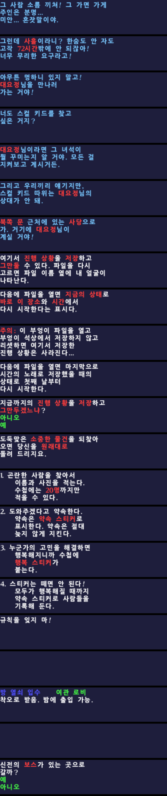

# 젤다의 전설 무쥬라의 가면 한글 패치 (Zelda64Recomp 모드)

[Zelda64Recomp](https://github.com/Zelda64Recomp/Zelda64Recomp)(Majora's Mask: Recompiled)용 비공식 한글화 모드입니다.



## 설치

1. [Releases](../../releases)에서 `mm_korean_translation.nrm`을 받습니다.
2. 리컴프를 실행한 뒤 파일을 게임 창에 끌어다 놓거나 **Mods → Install Mods**로 설치합니다.
   - 직접 넣으려면 `%LOCALAPPDATA%\Zelda64Recompiled\mods` (Linux: `~/.config/Zelda64Recompiled/mods`)에 복사합니다.
3. Mods 목록에서 **무쥬라의 가면 한글 패치**를 켜고 게임을 시작합니다.

리컴프 1.2.2 이상, 북미판(NTSC-U) ROM이 필요합니다. 이 저장소에는 ROM이나 게임 데이터가 들어 있지 않습니다.

## 번역 범위

- 게임 메시지 4,587개 중 4,477개 (나머지는 숫자·기호만 있는 메시지)
- 대화, 아이템 획득·설명, 표지판, 상점, 선택지, 봄버즈 수첩, 소문의 돌, 타틀 적 설명

**영어로 남는 부분**: 텍스처로 된 글자(일시정지 화면 아이템 이름, 지역 타이틀, "Dawn of the First Day"), 게임 코드가 직접 삽입하는 단어(서수, "hours", 부엉이 석상 지역명, 색깔 암호 등), 엔딩 크레딧, 플레이어 이름.

## 작동 방식

- `src/kr_patch.c`
  - `DmaMgr_RequestSync`를 후킹해 `message_data_static`에서 읽어 온 메시지를 한글 데이터로 바꿉니다.
  - 한글 한 글자는 자리표시 바이트 `0x80`으로 들어가고, 별도 표가 각 위치의 글리프 번호를 기억합니다.
  - `Font_LoadCharNES`를 후킹해 그 자리에 16×16 I4 한글 글리프를 넣고, `sNESFontWidths[0x60]`을 15로 설정합니다.
- 한글 글리프 997자는 나눔고딕 ExtraBold(SIL OFL)로 렌더링했습니다.

## 저장소 구성

| 경로 | 내용 |
|---|---|
| `src/kr_patch.c` | 후킹 코드 |
| `src/kr_data.c/.h` | 생성된 메시지·글리프 데이터 (`tools/gen_c.py` 출력) |
| `tools/ko/b00–b45.txt` | 번역 원고 (`@메시지ID` 다음 줄에 본문) |
| `tools/glossary.md` | 용어집 |
| `tools/*.py` | 파서, 검증기, 폰트 렌더러, 데이터 생성기 |

## 빌드

준비물: `clang`(mips 타깃 지원, LLVM 18 권장), `ld.lld`, `make`, `zip`, [N64Recomp](https://github.com/N64Recomp/N64Recomp)의 `RecompModTool`, Python 3 + Pillow.

```sh
git clone --recursive <이 저장소>
cd <저장소>

# 1) mm-decomp에 자기 소유 북미판 ROM을 넣고 추출합니다 (mm-decomp 문서 참고)
#    → mm-decomp/extracted/n64-us 가 생성되어야 합니다.

# 2) 번역 데이터를 생성합니다.
#    tools/fonts/NanumGothic-ExtraBold.ttf 에 나눔고딕을 넣어 두세요.
cd tools
python3 verify_en.py              # 원문 메시지 표 생성 (msgs.pkl)
python3 build_data.py --gen       # 번역 검증 후 src/kr_data.c 생성
cd ..

# 3) 모드를 빌드합니다.
make
RecompModTool mod.toml build      # build/mm_korean_translation.nrm
```

`build_data.py`는 이런 오류를 잡아냅니다.
- 원문과 제어 코드 순서가 다를 때
- 줄바꿈 후 상자가 4줄을 넘을 때
- 선택지 상자의 줄 수가 원문과 다를 때
- 폰트에 없는 문자가 들어갔을 때

## 번역 수정 · 제보

어색한 번역이나 글자가 넘치는 장면을 발견하면 Issue에 스크린샷과 대사를 올려 주세요. 수정은 `tools/ko/*.txt`에서 하면 됩니다.

## 라이선스

- 모드 템플릿과 코드: CC0 1.0 (`LICENSE`)
- 글리프 원본 폰트: 나눔고딕, SIL Open Font License 1.1
- 젤다의 전설 무쥬라의 가면은 Nintendo의 상표이자 저작물입니다. 이 프로젝트는 Nintendo와 관련이 없는 비공식 팬 번역입니다.
